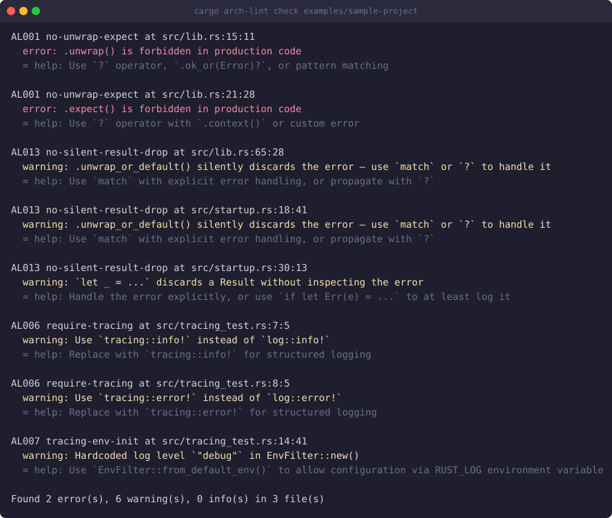

# arch-lint

Architecture linter for Rust projects and cross-language layer enforcement.

[](https://crates.io/crates/arch-lint)
[](LICENSE-MIT)
[](https://github.com/ynishi/arch-lint/actions/workflows/ci.yml)



## What it is

arch-lint catches the architectural mistake a PR review already caught once,
every time it happens again. Declare layering, scope, and dependency rules
in `arch-lint.toml` — no Rust code required — or write a custom `Rule` when
TOML is not enough. Rules run inside `cargo test` via `arch_lint::check!()`,
from the `cargo arch-lint` CLI, or embedded through the `Session` SDK. A
dual engine covers Rust (`syn`) today and other languages (Tree-sitter,
Kotlin first) for cross-language layering.

## Install

- **CLI**: `cargo install --locked arch-lint-cli` — installs both `arch-lint`
  and `cargo-arch-lint` (so `cargo arch-lint ...` works too).
- **`cargo binstall`**: `cargo binstall arch-lint-cli` — downloads the
  prebuilt archive for your platform from the Releases page instead of
  compiling. binstall reads the `[package.metadata.binstall]` table of the
  version it is installing, so this works from 0.9.0 on; earlier releases
  predate that table and still compile from source.
- **`cargo test` route**: `cargo add --dev arch-lint`, then add
  `arch_lint::check!();` to a test file (see Quick Start below).
- **Prebuilt archives**: on the
  [Releases page](https://github.com/ynishi/arch-lint/releases), one archive
  per platform containing both `arch-lint` and `cargo-arch-lint`, each with
  its own `.sha256` checksum file.
- **GitHub Action**: `uses: ynishi/arch-lint@arch-lint-v0.10.0` — installs
  the CLI and uploads SARIF to code scanning in one step (pin a release tag,
  for example `arch-lint-v0.9.0` — the first to ship the action and the
  hook; see [docs/cli.md](docs/cli.md#github-actions)).

## Quick Start (30 seconds)

```bash
cargo add --dev arch-lint
```

```rust
// tests/architecture.rs
arch_lint::check!();  // expands to a #[test] function
```

```bash
cargo install --locked arch-lint-cli
cargo arch-lint init
```

This creates `arch-lint.toml` with sensible defaults (unwrap/sync-io checks
enabled).

```bash
cargo test
```

Every rule violation now fails your test suite. To see violations directly
instead of through `cargo test`:

```bash
cargo arch-lint check
```

## What You Can Declare

Scopes plus two checks, each catching a different kind of
mistake — `[[layering]]` an upward dependency, `[[independent]]` a
dependency between two features that must stay apart:

```toml
[[scopes]]
name = "app"
paths = ["src/app/**"]

[[scopes]]
name = "domain"
paths = ["src/domain/**"]

[[scopes]]
name = "infra"
paths = ["src/infra/**"]

[[layering]]
order = ["app", "domain", "infra"]  # top to bottom; upward deps are violations
message = "Layers may only depend downward"

[[scopes]]
name = "billing"
paths = ["src/billing/**"]

[[scopes]]
name = "shipping"
paths = ["src/shipping/**"]

[[independent]]
scopes = ["billing", "shipping"]
```

On a project where `src/infra/mod.rs` imports back from `domain`, and
`src/billing/mod.rs` imports from `shipping`, `cargo arch-lint check`
(real output, both violations, nothing trimmed) prints:

```text
ALD010 independent at src/billing/mod.rs:1:22
  error: Independent scopes billing and shipping must not depend on each other: billing → shipping

ALD004 layering at src/infra/mod.rs:1:20
  error: Layers may only depend downward: `crate::domain::service` (scope `infra` → scope `domain`)

Found 2 error(s), 0 warning(s), 0 info(s) in 6 file(s)
```

See [Declarative Rules](docs/declarative-rules.md) for the rest: naming,
attributes, cycles, allow-lists, and
[how to suppress any of it](docs/suppression.md#declarative-rules-ald001-ald011).

## AI Coding Integration

arch-lint is designed to work as a guardrail for AI-generated code. Since `check!()` integrates into `cargo test`, any AI coding workflow that runs tests automatically gets arch-lint enforcement for free:

- **Claude Code / Cursor / Copilot** — AI runs `cargo test` as part of its feedback loop; arch-lint violations surface immediately
- **CI/CD** — AI-generated PRs are checked by the same rules as human PRs
- **CLAUDE.md / .cursorrules** — Point the AI at `arch-lint.toml` to explain project constraints upfront

The goal: the AI learns from the same rule set that humans follow, and neither needs to remember past review feedback.

## Documentation

- [docs/declarative-rules.md](docs/declarative-rules.md) — scopes, layering, naming, attributes, cycles, independence, and allow-lists, all declared in `arch-lint.toml`.
- [docs/rules.md](docs/rules.md) — the built-in rule reference (AL001-AL013), their options, and presets.
- [docs/configuration.md](docs/configuration.md) — `arch-lint.toml` structure, `[analyzer]` options, and the JSON Schema committed at `schema/arch-lint.schema.json` (served for SchemaStore and editor completion).
- [docs/suppression.md](docs/suppression.md) — line, block, file, and project-wide suppression, and when a reason is mandatory.
- [docs/cli.md](docs/cli.md) — CLI subcommands, exit codes, baseline adoption, and CI integration (GitHub Actions, SARIF, pre-commit).
- [docs/sdk.md](docs/sdk.md) — the `check!()` macro options, writing a custom `Rule` in Rust, and the `Session` / `TsSession` programmatic API.
- [docs/tree-sitter-engine.md](docs/tree-sitter-engine.md) — the cross-language (Tree-sitter) engine for non-Rust layers.

## Comparison with Other Tools

Columns answer the questions a visitor actually has: does it need nightly,
where do rules live, does it run inside `cargo test`, does it have the three
project-wide graph checks arch-lint added in ALD009-ALD011, does it support a
baseline for adopting on an existing codebase, and does it speak SARIF for
GitHub code scanning. `—` means the tool's own docs, linked below, do not
state it; it is not a claim that the feature is missing.

| Tool | Stable toolchain? | Rules: config or code | Runs in `cargo test`? | Cycle · independence · allow-list | Baseline | SARIF |
|---|---|---|---|---|---|---|
| **arch-lint** | Yes | TOML or Rust `Rule` | Yes (`check!()`) | Yes · Yes · Yes (ALD009 · ALD010 · ALD011) | Yes | Yes |
| cargo-pup | No (pinned nightly + `rustc-dev`) | Rust `LintBuilder` or `pup.ron` (RON) | — | No · No · No | No | No |
| ArchUnitRust | — | Rust fluent API (code) | Yes (`#[test]` + `assert_passes!`) | Yes · Yes · No | No | No |
| cargo-modules | — | CLI flags (analysis tool, not a rule-authoring system) | — | Yes · No · No | No | No |
| cargo-strata | — | TOML (`strata.toml`) | — | No · No · Yes | No | No |
| dylint | — | Rust lint libraries + `dylint.toml` / `workspace.metadata` | — | — · — · — | — | No |
| clippy | Yes (ships with the toolchain) | Config selects built-in lints (`clippy.toml`, `[lints]`, `#[allow]`); no custom-rule authoring | — | No · No · No (not an architecture tool) | — | Third-party only (`clippy-sarif`) |
| cargo-deny | — | TOML (`deny.toml`) | — | No · No · No | No | Yes |
| ArchUnit (Java) | n/a (JVM) | Java fluent DSL (code) + `archunit.properties` | n/a (JUnit equivalent) | Yes · Yes · Yes | Yes (`FreezingArchRule`) | No |

arch-lint complements Clippy by focusing on **architectural patterns** rather
than code style; the tree-sitter engine extends this to non-Rust languages
(Kotlin first, more planned).

Sources (each tool's own docs):

- cargo-pup: <https://github.com/DataDog/cargo-pup>
- ArchUnitRust: <https://github.com/LukasNiessen/ArchUnitRust>
- cargo-modules: <https://github.com/regexident/cargo-modules>
- cargo-strata: <https://github.com/uw-syfi/cargo-strata>
- dylint: <https://github.com/trailofbits/dylint>
- clippy: <https://doc.rust-lang.org/clippy/usage.html>
- cargo-deny: <https://embarkstudios.github.io/cargo-deny/cli/common.html>
- ArchUnit: <https://www.archunit.org/userguide/html/000_Index.html>

## Crate Structure

| Crate | Description |
|-------|-------------|
| `arch-lint` | Facade crate (re-exports core + macros) |
| `arch-lint-core` | Core framework (traits, analyzer, types) |
| `arch-lint-rules` | Built-in lint rules (syn engine) |
| `arch-lint-ts` | Tree-sitter engine (cross-language layer enforcement) |
| `arch-lint-cli` | Command-line interface |
| `arch-lint-macros` | Procedural macros (`#[arch_lint::allow(...)]`) |

## Contributing

Contributions are welcome. [CONTRIBUTING.md](CONTRIBUTING.md) has the
workflow (issues, branches, checks, pull requests) and
[PUBLIC_DEVELOPMENT.md](PUBLIC_DEVELOPMENT.md) says what may appear in a
public artifact.

## License

Licensed under either of:

- Apache License, Version 2.0 ([LICENSE-APACHE](LICENSE-APACHE))
- MIT license ([LICENSE-MIT](LICENSE-MIT))

at your option.
